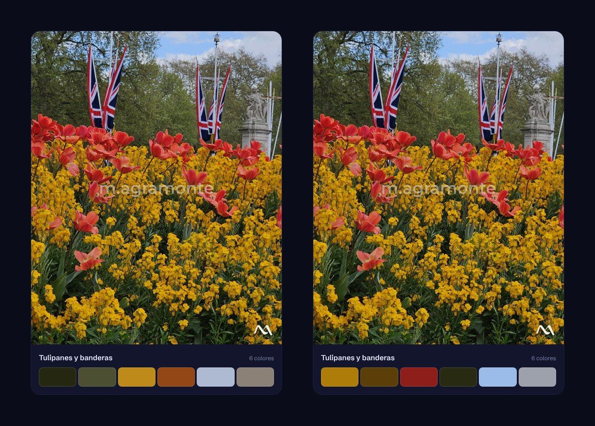

# Photo Palette

[Español](README.md) · **English**

Turns a photo into a colour palette ready to paste into a website. You upload an image and get
back its colours in HEX and RGB, how much of the picture each one covers, and a `:root` block
you can copy with one click. The colours come from a hand-written k-means, with no third-party
colour libraries, and the photo is analysed in memory without being stored anywhere.

`Java 21` · `Spring Boot 3.5` · `JavaScript` · `Docker` · `GitHub Pages`

[](https://github.com/maragramonte/photo-palette/actions/workflows/tests.yml)


> The website, the code and the rest of the documentation are in Spanish. This page is the
> same README, translated.

---

## Why I built it

I wanted a backend project you could understand in ten seconds: you upload a photo and out
comes its palette. Behind that there had to be something worth defending in an interview, so
the algorithm is written by hand and the API has the limits of a service that shares a server
with another one.

Testing it with my own photos showed the real problem. Palette extractors return the colours
that cover the most pixels, and that gives palettes that are correct and dull: a full moon is
89 % black, and a night sky gives you five nearly identical blues. The one colour you took the
photo for is missing.

That's why there are two modes. `presentes` counts pixels; `vivos` looks for the colours you
remember. And that's why the feed only has my own photos, no stock images: the difference
between the two modes shows up with real photos.



---

## Try it

[The website is live](https://paleta.maragramonte.com/), and every `git push` to `main` that
touches the website publishes it again.

**The one-minute tour:** flip the **Vivos** switch and watch the whole feed change. The tulips
stop opening with the dark green of the leaves and open with the ochre of the yellow flowers;
the sky over the rooftop goes from a palette that is almost all bluish greys to only three
colours, and the first one is the roof tile. Then click any card and copy a colour. To finish,
**Probar con una de ejemplo** (try an example) sends a photo from the feed to the API and
computes the same palette live.

If you'd rather not click anything, [docs/CAPTURAS.md](docs/CAPTURAS.md) shows the website
screen by screen.

> **Deployment status.** The website runs on GitHub Pages and the API on Render's free plan.
> If nobody has used it for 15 minutes it goes to sleep, and the first upload takes less than a
> minute to wake it up; the website tells you and counts the seconds. The feed doesn't depend
> on it: its palettes live in a static JSON file.

---

## What it does

- **Two ways of reading a photo**, `presentes` and `vivos`, with a switch that changes the
  whole feed without reloading the page.
- **From 2 to 12 colours**, each with its HEX, its RGB, the percentage it covers and the CSS
  variable name it gets.
- **A `:root` block ready to paste**, and each colour can be copied on its own with a click or
  with Enter.
- **A preview** painted only with that palette: background, surface, text and button. The text
  picks white or black by computing the contrast, and shows the ratio so you can see it meets
  WCAG AA.
- **Upload your photo** by dragging it in or with the button, with its loading, error, API
  unavailable and retry states.
- **Probar con una de ejemplo** (try an example) for anyone who arrives without a photo at
  hand: it takes one from the feed and sends it to the live API. The palette that comes back is
  the same one as in `paletas.json`, which also shows that the k-means is deterministic and that
  the feed doesn't lie.
- **Readable errors**: the API answers with ProblemDetail and the website shows that text as it
  is, so the message you see was written by the backend for you to read.

What it **doesn't** do, on purpose: no accounts, no likes, no database, no history. Uploaded
photos are not stored.


---

## Architecture

Two pieces that are deployed separately. The website is static and doesn't need the API to
show the feed: its palettes are computed beforehand by the same Java code and published as a
JSON file. The API only comes into play when someone uploads a photo.

```
             web/fotos/*.jpg  →  [GeneradorPaletasJson]  →  web/paletas.json
                                   (same k-means, before the push)

[Browser]    →  [GitHub Pages]   HTML, CSS, JS, photos and paletas.json
     │
     └─ POST /api/paletas  →  [Spring Boot in Docker]
                                FiltroLimitePorIp   10 per minute per IP
                                ServicioPaletas     2 analyses at a time at most
                                LectorImagen        ≤ 40 MP, downsampled to ~40,000 px
                                ExtractorPaleta     k-means++ with a fixed seed
```

The backend has two packages: `dominio` (domain), which knows nothing about HTTP, and `web`,
which translates requests and errors. The frontend is HTML, CSS and JavaScript with no
framework and no build step.

**→ [docs/API.md](docs/API.md)**: the full contract, the parameters, the status codes and the
errors.

---

## Technical decisions

The four that best explain the project. The full reasoning, with what was ruled out and what
each one costs, is in **[docs/DECISIONES-TECNICAS.md](docs/DECISIONES-TECNICAS.md)**.

**Two modes, because counting pixels gives dull palettes.** `vivos` clusters with three times
as many centres, ignores shadows, drops the noise, sorts by saturation and discards colours that
repeat hue and brightness. That's why **it can return fewer colours than you ask for**, and
that is part of the contract: the sky over the rooftop gives two.
[→](docs/DECISIONES-TECNICAS.md#1-dos-modos-porque-contar-píxeles-da-paletas-apagadas)

**The k-means, written by hand and with a fixed seed.** Initial centres with k-means++ and a
seed that never changes: the same photo always gives the same palette. That's what makes it
possible to write tests, and what stops the feed from changing colour between deployments.
[→](docs/DECISIONES-TECNICAS.md#2-el-k-means-escrito-a-mano-y-con-semilla-fija)

**Limits designed for a shared server.** 10 MB, 40 MP read from the header before decoding
anything, two analyses at a time with a `Semaphore`, and ten requests per minute per IP. The
real IP is only accepted from a trusted proxy, and a test makes sure that list isn't cut down,
because if it were, nothing visible would break.
[→](docs/DECISIONES-TECNICAS.md#3-límites-pensados-para-compartir-servidor)

**The feed doesn't need a server.** GitHub Pages doesn't run Java, so a command analyses the
photos with the same code as the API and leaves the result in `paletas.json`. No palette on the
website is written by hand, and the feed works just the same while the API is asleep.
[→](docs/DECISIONES-TECNICAS.md#4-el-feed-no-necesita-servidor)

---

## Testing and quality

```bash
mvn test
```

**98 tests** on two levels: 74 unit tests for the domain and the configuration, and 24 for the
HTTP layer with the whole application running and MockMvc. The ones that matter check product
decisions, not that the code runs: that the orange of the sun makes it into `vivos` and not
into `presentes`, that the same photo always gives the same palette, that a `.txt` renamed to
`.jpg` returns 422 and not 500, or that a 48 MP header is rejected without decoding a single
pixel.

API coverage is **97 % of lines and 91 % of branches** (JaCoCo), and `mvn verify` fails if it
drops below 90 and 85. The `paletas.json` generator has no tests: it's a tool that is run by
hand and stays outside that floor, although it shows up in the report.

On every push, CI runs `mvn verify` and builds the Docker image. Whatever reaches `main` is
also published to GitHub Container Registry, as `:latest` and as `:sha-xxxxxxx`:

```
docker run -p 8080:8080 ghcr.io/maragramonte/photo-palette:latest
curl -fsS http://localhost:8080/api/photo-palette   # 200 with no body
```

What **isn't** covered, plainly: the frontend has no automated tests and there are no E2E
tests. The load test (I03) is done and repeatable with `carga/i03.py`: 20 uploads of 10 MB at
the same time leave the container at 341 MB of its 512.

**→ [docs/PRUEBAS-Y-CALIDAD.md](docs/PRUEBAS-Y-CALIDAD.md)**

---

## Getting started

You need **JDK 21** and **Maven 3.9**. Nothing else: no database, no Node, no accounts.

```bash
mvn spring-boot:run -Dspring-boot.run.profiles=dev    # the API on localhost:8080
```

In another terminal, the website:

```bash
cd web && python -m http.server 8000                  # http://localhost:8000
```

Open it at `http://localhost:8000`, not by double-clicking the file: the feed reads
`paletas.json` with `fetch`, and `file://` blocks it. The `dev` profile is the only one that
accepts calls from `localhost`; without it, the API only answers browsers coming from
`https://paleta.maragramonte.com` (and from `https://maragramonte.github.io`, while visits keep
arriving through the old links).

| For | Document |
|-----|----------|
| How work is done in the repository and its rules | [docs/DESARROLLO.md](docs/DESARROLLO.md) |
| Changing the feed photos and regenerating the palettes | [web/fotos/LEEME.md](web/fotos/LEEME.md) |
| Deploying the API on your own server | [docs/DECISIONES-TECNICAS.md](docs/DECISIONES-TECNICAS.md#6-un-despliegue-que-no-se-ata-al-proveedor) |

---

## Repository structure

```
.
├── src/main/java/com/maragramonte/photopalette/
│   ├── dominio/      ExtractorPaleta (k-means), LectorImagen (safe reading),
│   │                 ServicioPaletas (semaphore), Modo, ColorPaleta, RespuestaPaleta
│   ├── web/          ControladorPaletas, ControladorEstado, ManejadorErrores (ProblemDetail),
│   │                 FiltroLimitePorIp (Bucket4j), FiltroSubidasEnCurso
│   ├── config/       ConfiguracionCors
│   └── cli/          GeneradorPaletasJson, the one that writes paletas.json
├── src/test/         98 tests: domain, configuration and HTTP layer
├── carga/i03.py      The load test against the docker-compose
├── herramientas/     marcar_fotos.py, which crops the photos and adds the mark and the signature
├── web/              The website published by GitHub Pages
│   ├── index.html · css/ · js/
│   ├── fotos/        The feed photos, their fotos.json and their LEEME
│   └── paletas.json  Generated. Not edited by hand
├── docs/             Documentation and screenshots
├── .github/          tests.yml (tests and Docker image), web.yml (Pages) and dependabot.yml
├── Dockerfile
└── docker-compose.yml   The API with 512 MB, listening only on loopback
```

The code and the comments are in Spanish, class names included. That's deliberate.

---

## Documentation

All of it is in Spanish.

| Document | Contents |
|----------|----------|
| [API.md](docs/API.md) | The endpoint, its parameters, the status codes and the ProblemDetail errors |
| [DECISIONES-TECNICAS.md](docs/DECISIONES-TECNICAS.md) | Why each solution was chosen, with what was ruled out and what it costs |
| [PRUEBAS-Y-CALIDAD.md](docs/PRUEBAS-Y-CALIDAD.md) | What is checked, how, and what isn't covered |
| [CAPTURAS.md](docs/CAPTURAS.md) | The website screen by screen, in pictures |
| [DESARROLLO.md](docs/DESARROLLO.md) | How work is done in the repository and its rules |
| [CONCEPTO.md](docs/CONCEPTO.md) | The concept, the sketch and the backlog: the source of truth |
| [web/fotos/LEEME.md](web/fotos/LEEME.md) | The feed photos, the watermark and how to change them |

---

## Where it's heading

- [ ] **P04**: The GIF of the flow for this README.
- [ ] Measure the distance between colours in CIELAB instead of RGB, closer to how we see them.
- [ ] Move the API to my own server if Render's free plan falls short.
- [x] **I02**: Lighthouse on mobile: performance from 96 to 100 and accessibility 100, after
      removing the first-paint blockers and raising two contrast tokens.
- [x] **I03**: Load test, 20 uploads of 10 MB at the same time against the same 512 MB. It
      passes with 171 MB to spare, after cutting off the extra uploads before reading them.
- [x] **D03**: The feed photos are real: sixteen, all with my mark and the m.agramonte
      signature.
- [x] **P02**: The API is deployed on Render and its URL lives in `web/js/config.js`.

---

## About me

I'm **Mar Agramonte**, a developer who has just graduated from the Higher Technician programme
in **Multiplatform Application Development** (DAM, in Spain).

I come from administration, and I made the move into development by building real projects,
not just class exercises. This is the most backend-focused one: a hand-written algorithm, an
API with the limits of a real service and tests that defend product decisions. The others are
[**Dr. Agramonte**](https://github.com/maragramonte/dr-agramonte), a medical appointments
platform in Java and Spring Boot, and
[**Farmàcia Agramonte**](https://github.com/maragramonte/Farmacia-Agramonte), the website of a
neighbourhood pharmacy.

I work with **Java, JavaScript, HTML, CSS and Python**. I use AI tools as active support (to
learn faster, debug and get unstuck), like any junior developer today. The technical decisions
in this repository, and being able to explain them, are mine.

I'm looking for my **first opportunity as a junior developer**, in Mallorca or remote, in a
team where I can keep growing and contribute from day one.

---

## Licence

© 2026 Mar Agramonte. All rights reserved.

The code and the photos are mine, and [LICENSE](LICENSE) **is not an open-source licence**: the
repository being public lets you read it, not reuse or adapt it without written permission. To
get a licence to use it, write to me.
