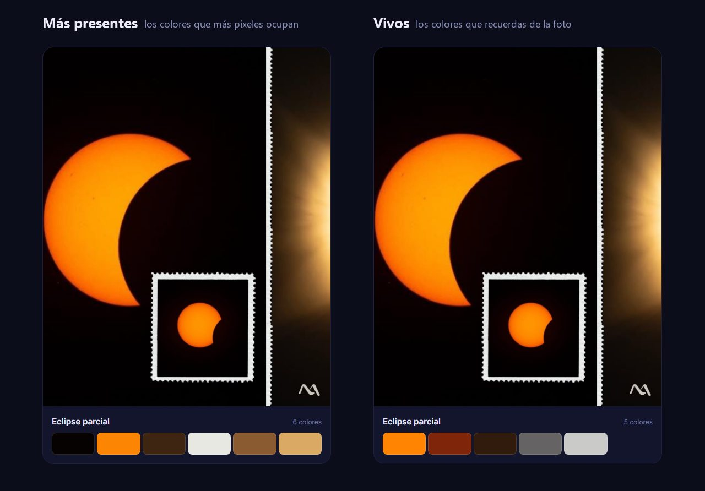
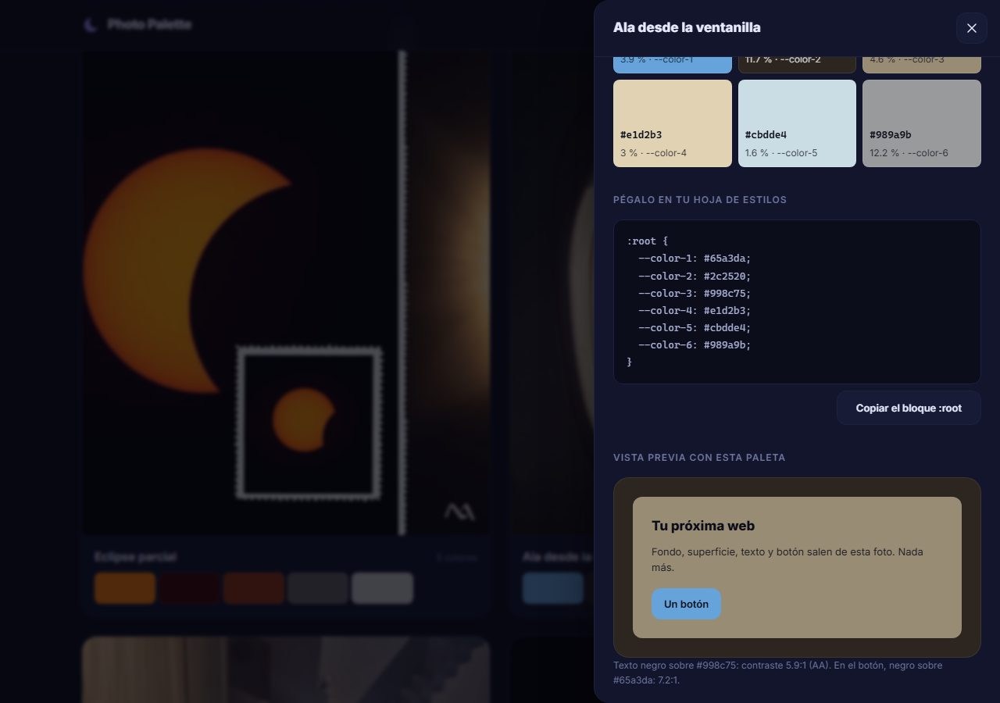

# Photo Palette

[Español](README.md) · **English**

Turns a photo into a colour palette you can paste straight into a website. You upload an
image and get back its colours in HEX and RGB, how much of the picture each one covers, and a
`:root` block you copy with one click. The colours come from a hand-written k-means, with no
third-party colour libraries, and the photo is analysed in memory and never stored.

`Java 21` · `Spring Boot 3.5` · `JavaScript` · `Docker` · `Render` · `GitHub Pages`

[](https://github.com/maragramonte/photo-palette/actions/workflows/tests.yml)


> The site, the code and the detailed documentation are in Spanish. This page is the short
> version for anyone who doesn't read it.

---

## Why I built it

I wanted a backend project you can understand in ten seconds: upload a photo, get its
palette. Behind that there had to be something worth defending in an interview, so the
algorithm is written by hand and the API has the limits of a service that shares a server
with others.

Testing it with my own photos showed the real problem. Palette extractors return the colours
that cover the most pixels, which gives palettes that are correct and dull: a full moon is
89 % black, and a night sky gives you five nearly identical blues. The one colour you took the
photo for is missing.

That's why there are two modes. `presentes` counts pixels; `vivos` looks for the colours you
remember. It's also why the feed only has my own photos and no stock images: the difference
between the two modes shows up with real photos.



---

## Try it

[The site is live](https://maragramonte.github.io/photo-palette/).

**The one-minute tour:** flip the switch to **Vivos** and watch the whole feed change. The
eclipse stops opening with black and opens with the sun's orange; the sky over the rooftop
goes from five blues to two colours, and the first one is the roof tile. Then open any card
and copy a colour, or press **Probar con una de ejemplo** to watch the API compute the same
palette live.

> **Deployment.** The site runs on GitHub Pages and the API on Render, in a container built
> from this repository's `Dockerfile`. The instance is on the free tier and **sleeps after
> fifteen minutes without traffic**, so if you're the first visitor in a while, the first
> request takes about thirty seconds. The site tells you while it wakes up, and the feed
> doesn't wait for it: its palettes live in a static JSON file.

---

## What it does

- **Two ways to read a photo**, `presentes` and `vivos`, with a switch that updates the whole
  feed without reloading.
- **2 to 12 colours**, each with HEX, RGB, the share of the image it covers and its CSS
  variable name.
- **A ready-to-paste `:root` block**, and every colour can be copied on its own with a click
  or with Enter.
- **A preview** painted only with that palette: background, surface, text and button. The
  text picks black or white by computing the contrast, and shows the ratio so you can see it
  meets WCAG AA.
- **Upload your own photo** by dragging it in or using the button, with loading, error,
  API-unavailable and retry states.
- **Readable errors**: the API answers with ProblemDetail and the site shows that text as is,
  so the message you read was written by the backend for you.

What it **doesn't** do, on purpose: no accounts, no likes, no database, no history. Uploaded
photos are not kept.



---

## Architecture

Two parts, deployed separately. The site is static and doesn't need the API to show the
feed: the same Java code computes those palettes ahead of time and publishes them as JSON.
The API only comes in when someone uploads a photo.

```
             web/fotos/*.jpg  →  [GeneradorPaletasJson]  →  web/paletas.json
                                   (same k-means, before the push)

[Browser]  →  [GitHub Pages]   HTML, CSS, JS, photos and paletas.json
     │
     └─ POST /api/paletas  →  [Spring Boot in Docker]
                                FiltroLimitePorIp   10 per minute per IP
                                ServicioPaletas     at most 2 analyses at once
                                LectorImagen        ≤ 40 MP, downsampled to ~40,000 px
                                ExtractorPaleta     k-means++ with a fixed seed
```

The backend has two packages: `dominio`, which knows nothing about HTTP, and `web`, which
translates requests and errors. The frontend is HTML, CSS and JavaScript with no framework and
no build step.

---

## Technical decisions

**Two modes, because counting pixels gives dull palettes.** `vivos` clusters with three
times as many centres, ignores shadows, drops noise, sorts by saturation and discards colours
that repeat hue and lightness. So it **can return fewer colours than you asked for**, and the
contract says so: the rooftop sky gives two.

**Hand-written k-means with a fixed seed.** Initial centres come from k-means++ with a seed
that never changes, so the same photo always gives the same palette. That's what makes it
testable, and what keeps the feed from changing colour between deployments.

**Limits designed for a shared server.** 10 MB, 40 MP read from the header before decoding
anything, two analyses at once behind a `Semaphore`, and ten requests per minute per IP. The
client IP is only trusted from a known proxy, and a test guards that list, because trimming
it wouldn't break anything you could see.

**The feed doesn't need a server.** GitHub Pages can't run Java, so a command analyses the
photos with the same code as the API and writes the result to `paletas.json`. None of the
palettes on the site are written by hand, and the feed works the same with the API asleep.

The full reasoning, with what was ruled out and what each choice costs, is in
[docs/DECISIONES-TECNICAS.md](docs/DECISIONES-TECNICAS.md) (Spanish).

---

## Tests

```bash
mvn test
```

**98 tests** on two levels: 74 unit tests for the domain and configuration, and 24 for the
HTTP layer with the whole application running under MockMvc. The ones that matter check
product decisions, not just that the code runs: that the sun's orange makes it into `vivos`
but not `presentes`, that the same photo always gives the same palette, that a `.txt` renamed
to `.jpg` gets a 422 and not a 500, or that a 48 MP header is rejected without decoding a
single pixel.

API coverage is **97 % of lines and 91 % of branches** (JaCoCo), and `mvn verify` fails if it
drops below 90 and 85. A load test (`carga/i03.py`) sends 20 uploads of 10 MB at once; the
container peaks at 341 MB of its 512.

What's **not** covered: the frontend has no automated tests and there are no end-to-end
tests.

CI runs `mvn verify` and builds the Docker image on every push. Whatever reaches `main` is
also published to GitHub Container Registry:

```
docker pull ghcr.io/maragramonte/photo-palette:latest
```

---

## Running it locally

You need **JDK 21** and **Maven 3.9**. Nothing else: no database, no Node, no accounts.

```bash
mvn spring-boot:run -Dspring-boot.run.profiles=dev    # the API on localhost:8080
cd web && python -m http.server 8000                  # the site on localhost:8000
```

Open it at `http://localhost:8000` rather than double-clicking the file: the feed loads
`paletas.json` with `fetch`, and `file://` blocks it. The `dev` profile is the only one that
accepts calls from `localhost`.

---

## About me

I'm **Mar Agramonte**, a recent graduate in Multiplatform Application Development (DAM, a
two-year higher vocational degree in Spain), based in Mallorca.

I came from office administration and moved into software by building real projects, not
just coursework. This is the most backend-focused one: a hand-written algorithm, an API with
real-world limits, and tests that defend product decisions. The others are
[**Dr. Agramonte**](https://github.com/maragramonte/dr-agramonte), a medical appointment
platform in Java and Spring Boot, and
[**Farmàcia Agramonte**](https://github.com/maragramonte/Farmacia-Agramonte), the website of
a neighbourhood pharmacy.

I use AI tools as active support, to learn faster, debug and get unstuck, like any junior
developer today. The technical decisions in this repository, and being able to explain them,
are mine.

I'm looking for my **first role as a junior developer**, in Mallorca or remote.

---

## Licence

© 2026 Mar Agramonte. All rights reserved.

The code and the photos are mine, and [LICENSE](LICENSE) **is not an open-source licence**:
the repository being public lets you read it, not reuse or adapt it without written
permission. Get in touch if you'd like a licence to use it.
