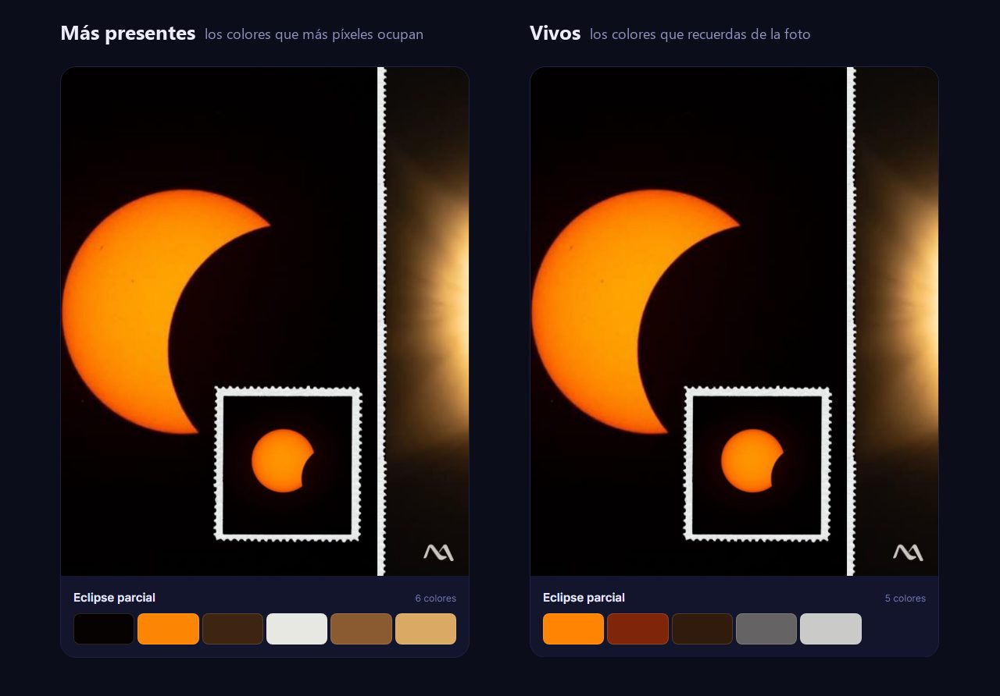

# Photo Palette

Convierte una foto en una paleta de color lista para pegar en una web. Subes la imagen y
te devuelve los colores en HEX y RGB, cuánto ocupa cada uno y un bloque `:root` que se copia
de un clic. Los calcula k-means escrito a mano, sin librerías de color de terceros, y la
foto se analiza en memoria sin guardarse en ningún sitio.

`Java 21` · `Spring Boot 3.5` · `JavaScript` · `Docker` · `Caddy` · `GitHub Pages`

[](https://github.com/maragramonte/photo-palette/actions/workflows/tests.yml)


---

## Por qué lo hice

Quería un proyecto de backend que se entendiera en diez segundos: subes una foto y sale su
paleta. Detrás tenía que haber algo que defender en una entrevista, así que el algoritmo está
escrito a mano y la API tiene los límites de un servicio que comparte servidor con otro.

Al probarlo con mis fotos salió el problema de verdad. Los extractores de paletas devuelven
los colores que más píxeles ocupan, y eso da paletas correctas y apagadas: la luna llena es
un 89 % de negro y en un cielo nocturno salen cinco azules casi iguales. Le falta justo el
color por el que hiciste la foto.

Por eso hay dos modos. `presentes` cuenta píxeles; `vivos` busca los colores que recuerdas.
Y por eso el feed solo tiene fotos mías, nada de stock: el contraste entre los dos modos se
ve con fotos reales.



---

## Probarlo

[La web está publicada](https://maragramonte.github.io/photo-palette/) y cada `git push` a
`main` que toque la web la vuelve a publicar.

**Para verlo en un minuto:** pulsa el interruptor **Vivos** y mira cómo cambia el feed
entero. El eclipse deja de abrir con negro y abre con el naranja del sol; el cielo con tejado
pasa de cinco azules a dos colores, y el primero es la teja. Después pulsa cualquier tarjeta y
copia un color, o dale a **Probar con una de ejemplo** para ver a la API calcular la misma
paleta en directo.

Si prefieres no pulsar nada, en [docs/CAPTURAS.md](docs/CAPTURAS.md) está la web pantalla a
pantalla.

> **Estado del despliegue.** Las dos piezas están en marcha: la web en GitHub Pages y la API
> en Render, en un contenedor construido con el `Dockerfile` de este repositorio. La
> instancia es gratuita y **se duerme a los quince minutos sin tráfico**, así que si eres el
> primero en llegar en un rato, la primera llamada tarda unos treinta segundos. La web lo
> avisa mientras despierta, y el feed no espera a nadie: sus paletas viven en un JSON
> estático.

---

## Qué hace

- **Dos formas de leer una foto**, `presentes` y `vivos`, con un interruptor que afecta al
  feed entero sin recargar la página.
- **De 2 a 12 colores**, con su HEX, su RGB, el porcentaje que ocupan y el nombre de variable
  CSS que les toca.
- **Un bloque `:root` listo para pegar**, y cada color se copia por separado con un clic o
  con Enter.
- **Vista previa** pintada solo con esa paleta: fondo, superficie, texto y botón. El texto
  elige blanco o negro calculando el contraste, y enseña la razón para que se vea que cumple
  WCAG AA.
- **Subir tu foto** arrastrándola o desde el botón, con sus estados de cargando, error, API
  no disponible y reintentar.
- **Probar con una de ejemplo** para quien llega sin foto a mano: coge una del feed y la
  manda a la API en vivo. Sale la misma paleta que en `paletas.json`, lo que enseña de paso
  que el k-means es determinista y que el feed no miente.
- **Errores legibles**: la API contesta en ProblemDetail y la web pinta ese texto tal cual,
  así que el mensaje que ves lo escribió el backend para que lo leyeras tú.

Lo que **no** hace, y es a propósito: ni cuentas, ni likes, ni base de datos, ni historial.
Las fotos subidas no se guardan.


---

## Arquitectura

Dos piezas que se despliegan por separado. La web es estática y no necesita la API para
enseñar el feed: sus paletas las calcula de antemano el mismo código Java y se publican en
un JSON. La API solo entra en juego cuando alguien sube una foto.

```
             web/fotos/*.jpg  →  [GeneradorPaletasJson]  →  web/paletas.json
                                   (mismo k-means, antes del push)

[Navegador]  →  [GitHub Pages]   HTML, CSS, JS, fotos y paletas.json
     │
     └─ POST /api/paletas  →  [Spring Boot en Docker]
                                FiltroLimitePorIp   10 por minuto y por IP
                                ServicioPaletas     2 análisis a la vez como mucho
                                LectorImagen        ≤ 40 MP, submuestreo a ~40.000 px
                                ExtractorPaleta     k-means++ con semilla fija
```

El backend va en dos paquetes: `dominio`, que no sabe nada de HTTP, y `web`, que traduce
peticiones y errores. El frontend es HTML, CSS y JavaScript sin framework ni paso de
compilación.

**→ [docs/API.md](docs/API.md)**: el contrato completo, los parámetros, los códigos de estado
y los errores.

---

## Decisiones técnicas

Las cuatro que mejor explican el proyecto. El razonamiento completo, con lo descartado y lo
que cuesta cada una, está en **[docs/DECISIONES-TECNICAS.md](docs/DECISIONES-TECNICAS.md)**.

**Dos modos, porque contar píxeles da paletas apagadas.** `vivos` agrupa con el triple de
centros, ignora las sombras, tira el ruido, ordena por saturación y descarta los colores que
repiten tono y brillo. Por eso **puede devolver menos colores de los que pides**, y eso está
en el contrato: en el cielo con tejado salen dos.
[→](docs/DECISIONES-TECNICAS.md#1-dos-modos-porque-contar-píxeles-da-paletas-apagadas)

**El k-means, escrito a mano y con semilla fija.** Centros iniciales con k-means++ y una
semilla que no cambia: la misma foto da siempre la misma paleta. Es lo que permite escribir
tests y lo que evita que el feed cambie de color entre despliegues.
[→](docs/DECISIONES-TECNICAS.md#2-el-k-means-escrito-a-mano-y-con-semilla-fija)

**Límites pensados para compartir servidor.** 10 MB, 40 MP leídos de la cabecera antes de
decodificar nada, dos análisis a la vez con un `Semaphore` y diez peticiones por minuto y por
IP. La IP real solo se acepta de un proxy de confianza, y un test vigila que esa lista no se
recorte, porque si se recortara no fallaría nada visible.
[→](docs/DECISIONES-TECNICAS.md#3-límites-pensados-para-compartir-servidor)

**El feed no necesita servidor.** GitHub Pages no ejecuta Java, así que un comando analiza
las fotos con el mismo código que la API y deja el resultado en `paletas.json`. Ningún color
de la web está escrito a mano, y el feed funciona igual con la API dormida.
[→](docs/DECISIONES-TECNICAS.md#4-el-feed-no-necesita-servidor)

---

## Pruebas y calidad

```bash
mvn test
```

**94 pruebas** en dos niveles: 70 unitarias del dominio y la configuración, y 24 de la capa
HTTP con la aplicación entera levantada y MockMvc. Las que importan comprueban decisiones de
producto, no que el código corre: que el naranja del sol entra en `vivos` y no en
`presentes`, que la misma foto da siempre la misma paleta, que un `.txt` renombrado a `.jpg`
da 422 y no 500, o que una cabecera de 48 MP se rechaza sin decodificar un píxel.

En cada push, el CI ejecuta `mvn verify` y construye la imagen Docker. Lo que llega a `main`
se publica además en GitHub Container Registry, como `:latest` y como `:sha-xxxxxxx`:

```
docker pull ghcr.io/maragramonte/photo-palette:latest
```

Lo que **no** está cubierto, dicho sin adornos: la cobertura no está medida (no hay JaCoCo),
el frontend no tiene pruebas automatizadas y no hay E2E. La prueba de carga (I03) está hecha
y repetible con `carga/i03.py`: 20 subidas de 10 MB a la vez dejan el contenedor en 341 MB
de sus 512.

**→ [docs/PRUEBAS-Y-CALIDAD.md](docs/PRUEBAS-Y-CALIDAD.md)**

---

## Puesta en marcha

Hace falta **JDK 21** y **Maven 3.9**. Nada más: ni base de datos, ni Node, ni cuentas.

```bash
mvn spring-boot:run -Dspring-boot.run.profiles=dev    # la API en localhost:8080
```

En otra terminal, la web:

```bash
cd web && python -m http.server 8000                  # http://localhost:8000
```

Ábrela en `http://localhost:8000`, no con doble clic en el archivo: el feed lee
`paletas.json` con `fetch` y `file://` lo bloquea. El perfil `dev` es el único que acepta
llamadas desde `localhost`; sin él, la API solo responde al navegador desde
`https://maragramonte.github.io`.

| Para | Documento |
|------|-----------|
| Cómo se trabaja en el repositorio y sus reglas | [docs/DESARROLLO.md](docs/DESARROLLO.md) |
| Cambiar las fotos del feed y regenerar las paletas | [web/fotos/LEEME.md](web/fotos/LEEME.md) |
| Desplegar la API en Render o en un servidor propio | [docs/DECISIONES-TECNICAS.md](docs/DECISIONES-TECNICAS.md#6-un-despliegue-que-no-se-ata-al-proveedor) |

---

## Estructura del repositorio

```
.
├── src/main/java/com/maragramonte/photopalette/
│   ├── dominio/      ExtractorPaleta (k-means), LectorImagen (lectura segura),
│   │                 ServicioPaletas (semáforo), Modo, ColorPaleta, RespuestaPaleta
│   ├── web/          ControladorPaletas, ControladorSalud, ManejadorErrores (ProblemDetail),
│   │                 FiltroLimitePorIp (Bucket4j), FiltroSubidasEnCurso
│   ├── config/       ConfiguracionCors
│   └── cli/          GeneradorPaletasJson, el que escribe paletas.json
├── src/test/         94 pruebas: dominio, configuración y capa HTTP
├── carga/i03.py      La prueba de carga contra el docker-compose
├── web/              La web que publica GitHub Pages
│   ├── index.html · css/ · js/
│   ├── fotos/        Las seis fotos del feed, su fotos.json y su LEEME
│   └── paletas.json  Generado. No se edita a mano
├── docs/             Documentación y capturas
├── .github/workflows/   tests.yml (tests e imagen Docker) y web.yml (Pages)
├── Dockerfile
└── docker-compose.yml   La API con 512 MB, escuchando solo en el loopback
```

El código y los comentarios están en español, nombres de clase incluidos. Es deliberado.

---

## Documentación

| Documento | Contenido |
|-----------|-----------|
| [API.md](docs/API.md) | El endpoint, sus parámetros, los códigos de estado y los errores en ProblemDetail |
| [DECISIONES-TECNICAS.md](docs/DECISIONES-TECNICAS.md) | Por qué se eligió cada solución, con lo descartado y lo que cuesta |
| [PRUEBAS-Y-CALIDAD.md](docs/PRUEBAS-Y-CALIDAD.md) | Qué se comprueba, cómo, y qué no queda cubierto |
| [CAPTURAS.md](docs/CAPTURAS.md) | La web pantalla a pantalla, en imágenes |
| [DESARROLLO.md](docs/DESARROLLO.md) | Cómo se trabaja en el repositorio y sus reglas |
| [CONCEPTO.md](docs/CONCEPTO.md) | El concepto, el sketch y el backlog: la fuente de la verdad |
| [web/fotos/LEEME.md](web/fotos/LEEME.md) | Las fotos del feed, la marca de agua y cómo cambiarlas |

---

## Hacia dónde va

- [ ] **I02**: Pasar Lighthouse en móvil y dejarlo en 90 o más.
- [ ] **P04**: El GIF del flujo para este README.
- [ ] Medir la distancia entre colores en CIELAB en lugar de RGB, más cerca de cómo los vemos.
- [ ] Llevar la API a servidor propio cuando haya dominio que decidir.
- [x] **I03**: Prueba de carga, 20 subidas de 10 MB a la vez contra los mismos 512 MB. Pasa
      con 171 MB de margen, después de cortar las subidas sobrantes antes de leerlas.
- [x] **D03**: Las seis fotos del feed son reales y llevan mi marca de agua.
- [x] **P02**: La API está desplegada en Render y su URL vive en `web/js/config.js`.

---

## Sobre mí

Soy **Mar Agramonte**, desarrolladora recién graduada en el Ciclo Superior de **Desarrollo de
Aplicaciones Multiplataforma**.

Vengo de administración y he hecho la transición a desarrollo construyendo proyectos reales,
no solo ejercicios de clase. Este es el más centrado en el backend: un
algoritmo escrito a mano, una API con los límites de un servicio de verdad y unos tests que
defienden decisiones de producto. Los otros son
[**Dr. Agramonte**](https://github.com/maragramonte/dr-agramonte), una plataforma de citas
médicas en Java y Spring Boot, y
[**Farmàcia Agramonte**](https://github.com/maragramonte/Farmacia-Agramonte), la web de una
farmacia de barrio.

Trabajo con **Java, JavaScript, HTML, CSS y Python**. Uso herramientas de IA como apoyo activo
(para aprender más rápido, depurar y desatascarme) igual que cualquier desarrolladora junior
hoy. Las decisiones técnicas de este repositorio, y el saber explicarlas, son mías.

Busco mi **primera oportunidad como desarrolladora junior**, en Mallorca o en remoto, en un
equipo donde seguir creciendo y aportar desde el primer día.

---

## Licencia

© 2026 Mar Agramonte. Todos los derechos reservados.

El código y las fotos son míos, y [LICENSE](LICENSE) **no es una licencia libre**: que el
repositorio sea público permite leerlo, no reutilizarlo ni adaptarlo sin permiso escrito.
Para una licencia de uso, escríbeme.
