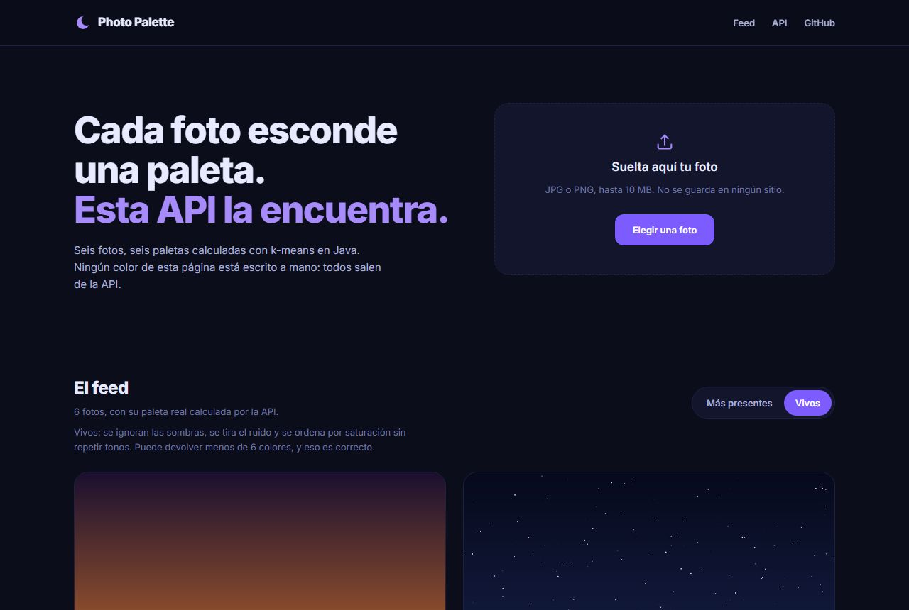
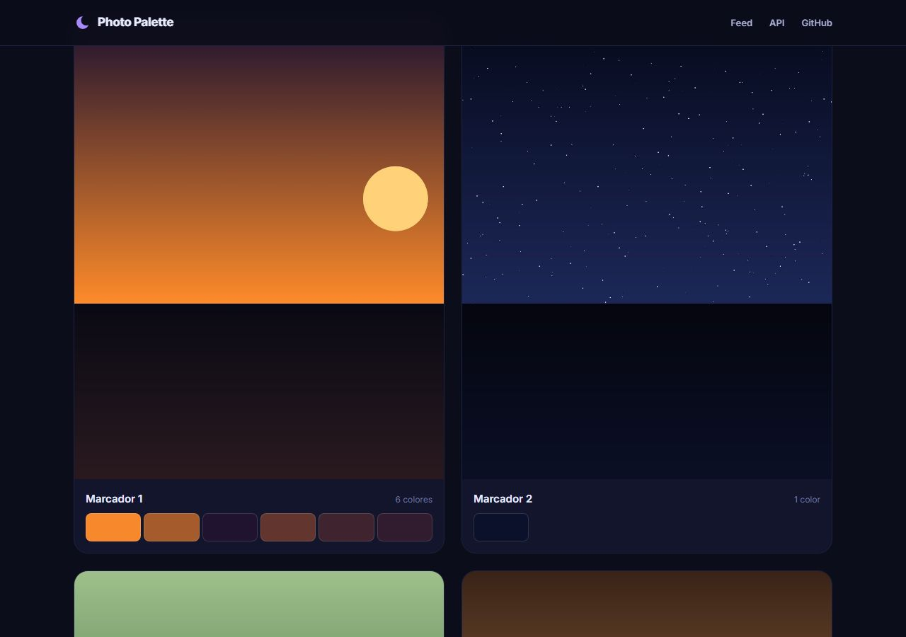
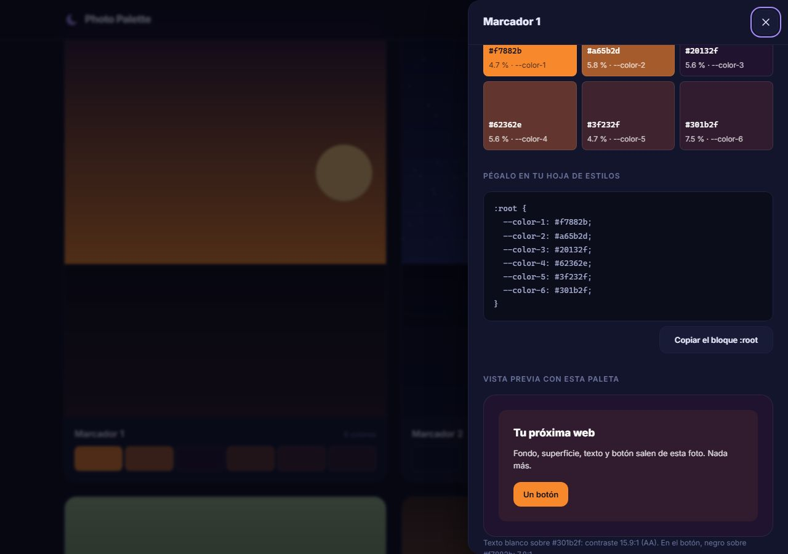

# Photo Palette

Convierte una foto en una paleta de color lista para pegar en una web. Subes la imagen y
te devuelve los colores en HEX y RGB, cuánto ocupa cada uno y un bloque `:root` que se copia
de un clic. Los calcula k-means escrito a mano, sin librerías de color de terceros, y la
foto se analiza en memoria sin guardarse en ningún sitio.

`Java 21` · `Spring Boot 3.5` · `JavaScript` · `Docker` · `Caddy` · `GitHub Pages`

[](https://github.com/maragramonte/photo-palette/actions/workflows/tests.yml)

### 👉 **<https://maragramonte.github.io/photo-palette/>**



---

## El problema

Un extractor de paletas corriente te da los colores que más píxeles ocupan. Es exacto y casi
siempre inútil. En un atardecer, los dos tonos oscuros se comen más de la mitad de la imagen
y el naranja del sol no llega al 6 %: la paleta sale correcta, apagada y sin el color por el
que hiciste la foto. En un cielo estrellado salen cuatro azules casi iguales.

Quien busca una paleta no quiere un inventario de la imagen. Quiere los cuatro colores con
los que podría pintar una web mañana.

**La decisión de producto que define este proyecto es que la paleta fiel no es la paleta
útil**, y que las dos merecen existir. De ahí los dos modos: `presentes` cuenta píxeles,
`vivos` busca los colores que uno recuerda de la foto. El interruptor del feed las enseña
una al lado de la otra, que es la mejor forma de explicar por qué hacía falta la segunda.

---

## Probarlo

**▶ [La web está publicada](https://maragramonte.github.io/photo-palette/).** Cada `git push`
a `main` la republica sola. Las seis fotos del feed llevan su paleta real: ni un solo color
de esa página está escrito a mano.

**Para verlo en diez segundos:** dale al interruptor **Vivos** y mira cómo cambia el feed
entero. La foto gris de abajo a la derecha saca de pronto un rojo que `presentes` ni ve.
Después pulsa cualquier tarjeta y copia un color.

> **Estado del despliegue.** La web está en marcha; **la API todavía no**. Por eso la zona
> de subida aparece apagada con el motivo escrito. El feed funciona igual, porque sus
> paletas viven en un JSON estático. Para levantar la API en tu máquina, abajo están los dos
> comandos.



---

## Qué hace

- **Dos formas de leer una foto**, `presentes` y `vivos`, con un interruptor que afecta al
  feed entero sin recargar la página.
- **De 2 a 12 colores**, con su HEX, su RGB, el porcentaje que ocupan y el nombre de variable
  CSS que les toca.
- **Un bloque `:root` listo para pegar**, y cada color se copia por separado con un clic o
  con Enter.
- **Vista previa** pintada solo con esa paleta: fondo, superficie, texto y botón. El texto
  elige blanco o negro calculando el contraste, y enseña la razón resultante para que se vea
  que cumple WCAG AA.
- **Subir tu foto** arrastrándola o desde el botón, con sus estados de cargando, error, API
  no disponible y reintentar.
- **Errores legibles**: la API contesta en ProblemDetail y la web pinta ese texto tal cual,
  así que el mensaje que ves lo escribió el backend para que lo leyeras tú.

Lo que **no** hace, y es a propósito: ni cuentas, ni likes, ni base de datos, ni historial.
Las fotos subidas no se guardan.



---

## Los dos modos

`presentes` agrupa los píxeles y los ordena por cuántos hay. Fin.

`vivos` hace cinco cosas más:

1. Agrupa con `k = 3n` en vez de `k = n`, para que un color minoritario tenga grupo propio
   en lugar de disolverse dentro del grupo grande.
2. Ignora los píxeles por debajo de 0,15 de brillo. Una sombra no es un color.
3. Descarta los grupos con menos del 0,5 % de los píxeles con luz. Eso es ruido del sensor o
   una mota, no un color de la foto.
4. Ordena por saturación, no por tamaño.
5. Descarta el color que repite **el tono y el brillo** de uno ya elegido. Los cuatro azules
   casi iguales de un cielo nocturno colapsan en uno; el marrón de la sombra y el naranja del
   sol, que comparten tono pero no brillo, sobreviven los dos, porque para quien va a pintar
   una web ese par es justo el útil.

Por eso `vivos` **puede devolver menos colores de los que pides**, y uno solo si la foto es
monocroma. No es un fallo: está en el contrato y el feed lo pinta bien.

---

## La API

`POST /api/paletas` · `multipart/form-data`, campo `imagen`

```bash
curl -X POST "https://TU-API/api/paletas?n=6&modo=vivos" -F imagen=@atardecer.jpg
```

```json
{
  "modo": "vivos",
  "colores": [
    { "hex": "#f7882b", "rgb": [247, 136, 43], "porcentaje": 4.7, "variable": "--color-1" }
  ],
  "css": ":root {\n  --color-1: #f7882b;\n}"
}
```

| Parámetro | Valores | Por defecto | Qué hace |
| --- | --- | --- | --- |
| `imagen` | JPG o PNG, máx. 10 MB | — | La foto. En memoria, sin guardarse |
| `n` | 2–12 | 6 | Cuántos colores devolver |
| `modo` | `presentes` · `vivos` | `presentes` | Cómo se eligen y se ordenan |

| Código | Cuándo |
| --- | --- |
| `200` | Paleta calculada. En `vivos` pueden venir menos de `n` colores |
| `400` | Falta la imagen, o `n` o `modo` no son válidos |
| `413` | La imagen pasa de 10 MB |
| `422` | No es un JPG o PNG legible, o pasa de 40 megapíxeles |
| `429` | Esa IP ha superado 10 análisis por minuto |
| `503` | Ya hay 2 análisis en curso. Reintenta en unos segundos |

Los errores van en **ProblemDetail (RFC 9457)**, con `title` y `detail` en español escritos
para que los lea una persona, no un log:

```json
{
  "type": "https://maragramonte.github.io/photo-palette/errores/imagen-ilegible",
  "title": "No se puede leer la imagen",
  "status": 422,
  "detail": "El archivo no es un JPG ni un PNG. Comprueba que la extensión coincide con el contenido.",
  "instance": "/api/paletas"
}
```

`GET /api/salud` responde `200` sin cuerpo y queda fuera del límite por IP. La web lo
consulta al cargar: si falla, apaga la subida con un aviso y el feed sigue funcionando.

**WebP no se admite.** El `ImageIO` del JDK no lo lee y no se añade la dependencia.

---

## Cómo funciona el k-means

`ExtractorPaleta` agrupa los píxeles en el espacio RGB. Lo que importa:

1. **La foto no se decodifica entera.** `LectorImagen` lee primero solo las dimensiones de
   la cabecera y rechaza más de 40 MP; después decodifica con `setSourceSubsampling`
   saltando píxeles hasta dejar unos 40.000. Una foto de 12 MP, que serían 48 MB en memoria,
   se queda en unos cientos de kilobytes.
2. **Los centros iniciales se eligen con k-means++**: el primero al azar y cada siguiente con
   probabilidad proporcional a su distancia al centro más cercano ya elegido. Sembrar del
   todo al azar da paletas distintas en cada ejecución, y a veces absurdas.
3. **Se itera** asignando cada píxel a su centro más cercano y recolocando cada centro en la
   media de los suyos, hasta que nadie cambia de grupo o se llega a 30 vueltas.
4. **La semilla es fija.** La misma foto da siempre la misma paleta: es lo que permite
   escribir tests y lo que evita que el feed cambie de color entre despliegues.
5. Los grupos vacíos se descartan. Pedirle 6 colores a una foto que solo tiene 3 devuelve 3.

La distancia es euclídea sobre RGB. Es la que peor se parece a cómo vemos los colores
—CIELAB sería más fiel—, pero es la que se entiende de un vistazo y la que hace necesario el
modo `vivos`. Cambiarla es una mejora futura, no una corrección pendiente.

---

## Los límites, y por qué están

Esta API va a compartir VPS con otro proyecto. Los límites existen para que un pico de uso no
se lleve por delante al vecino:

| Límite | Valor | Qué pasa si no está |
| --- | --- | --- |
| Tamaño del archivo | 10 MB | Un POST de 500 MB llena el disco del multipart |
| Megapíxeles | 40 MP | Una foto de 200 MP reserva 800 MB antes de hacer nada |
| Muestra del k-means | ~40.000 píxeles | El análisis pasa de milisegundos a segundos |
| Análisis simultáneos | 2 (`Semaphore`) | Diez a la vez se comen los 512 MB del contenedor |
| Peticiones por IP | 10 por minuto (Bucket4j) | Un script sin navegador tumba el VPS gratis |
| Memoria del contenedor | 512 MB (`mem_limit`) | El OOM killer elige a quién matar, y puede no ser este |

**CORS no es ninguno de estos.** Solo decide qué webs pueden llamar a la API desde el
navegador; un script sin navegador lo ignora. Está para que nadie monte una copia de esta web
sobre tu servidor, no para protegerte del abuso.

Detrás de Caddy, la IP real llega en `X-Forwarded-For`. La aplicación arranca con
`server.forward-headers-strategy=native`, así que Tomcat la lee, pero **solo** cuando la
conexión viene de un proxy de la red interna de Docker. Como el puerto 8080 no se publica
fuera del VPS, una cabecera falsa desde internet no llega a tocarla.

---

## El feed sin servidor

GitHub Pages no ejecuta Java, así que el feed no puede llamar a la API al cargar. En su
lugar, un comando analiza las fotos con el mismo código y deja el resultado en un JSON:

```bash
mvn compile exec:java@paletas     # web/fotos/*.jpg → web/paletas.json
```

Consecuencia buscada: **ningún color de la web está escrito a mano**, y el feed sigue
funcionando con la API caída. Para cambiar las fotos, mira
[`web/fotos/LEEME.md`](web/fotos/LEEME.md).

---

## Arrancarlo

Hace falta **JDK 21** y **Maven 3.9**. Nada más: ni base de datos, ni Node, ni cuentas.

```bash
mvn test                                              # 77 tests
mvn spring-boot:run -Dspring-boot.run.profiles=dev    # la API en localhost:8080
```

En otra terminal, la web:

```bash
cd web && python -m http.server 8000                  # http://localhost:8000
```

Ábrela en `http://localhost:8000`, no con doble clic en el archivo: el feed lee
`paletas.json` con `fetch` y `file://` lo bloquea. El perfil `dev` es el único que acepta
llamadas desde `localhost`; sin él, la API solo responde al navegador desde
`https://maragramonte.github.io`.

Cómo se trabaja en el repositorio, en [docs/DESARROLLO.md](docs/DESARROLLO.md). El concepto,
el sketch y el backlog, en
[Photo Palette — concepto, sketch y backlog.md](Photo%20Palette%20%E2%80%94%20concepto,%20sketch%20y%20backlog.md).

---

## Qué hay dentro

```
src/main/java/com/maragramonte/photopalette/
  dominio/   ExtractorPaleta (k-means), LectorImagen (lectura segura),
             ServicioPaletas (semáforo), Modo, ColorPaleta, RespuestaPaleta
  web/       ControladorPaletas, ControladorSalud, ManejadorErrores (ProblemDetail),
             FiltroLimitePorIp (Bucket4j)
  config/    ConfiguracionCors
  cli/       GeneradorPaletasJson
web/
  index.html, css/tokens.css, css/app.css, js/app.js, js/config.js
  fotos/        las fotos del feed y su fotos.json
  paletas.json  generado, no se edita a mano
```

El código y los comentarios están en español, nombres de clase incluidos. Es deliberado.

---

## Tests

```bash
mvn test
```

77 tests. Los que importan no comprueban que el código corre, sino que las decisiones de
producto se cumplen:

- El naranja del sol entra entre los tres primeros colores en `vivos` y **no** entra en
  `presentes`. Es el test que justifica que el modo exista.
- Un cielo de cuatro azules casi iguales devuelve menos de 6 colores.
- Un `.txt` renombrado a `.jpg` da 422, no un 500.
- Una cabecera de PNG de 48 MP se rechaza **sin decodificar un píxel**.
- Dos IP distintas detrás del proxy tienen cupos separados, y la que se pasa recibe un 429
  con su `Retry-After`.
- Ese 429 lleva cabeceras CORS, para que la web pueda enseñar el motivo en lugar de un error
  de red.

---

## Desplegar

**La web** va a GitHub Pages: el workflow [`web.yml`](.github/workflows/web.yml) publica la
carpeta `web/` en cada push. Antes, pon la URL de tu API en
[`web/js/config.js`](web/js/config.js).

**La API** va al VPS, en su propio contenedor:

```bash
docker compose up -d --build
curl -fsS http://localhost:8080/api/salud   # 200 sin cuerpo
```

Caddy delante, con HTTPS. El contenedor no publica el 8080 a internet: solo escucha en el
loopback del servidor.

---

## Lo que falta

- [ ] **D03** — Las seis fotos del feed son relleno generado. Cambiarlas por las reales
      ([`web/fotos/LEEME.md`](web/fotos/LEEME.md)) y volver a ejecutar el generador.
- [ ] **I02** — Pasar Lighthouse en móvil y dejarlo en 90 o más.
- [ ] **I03** — Prueba de carga: 20 subidas de 10 MB a la vez contra el mismo
      `docker-compose`. **Sin esto, la subida no se publica.**
- [ ] **P02** — Desplegar la API. Antes hay que decidir su dominio.
- [ ] **P04** — El GIF del flujo para este README.

---

Fotos y código de [Mar Agramonte](https://github.com/maragramonte).
