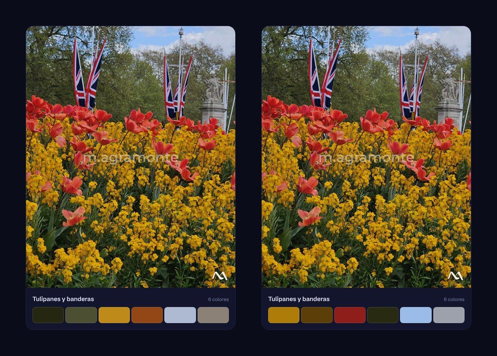
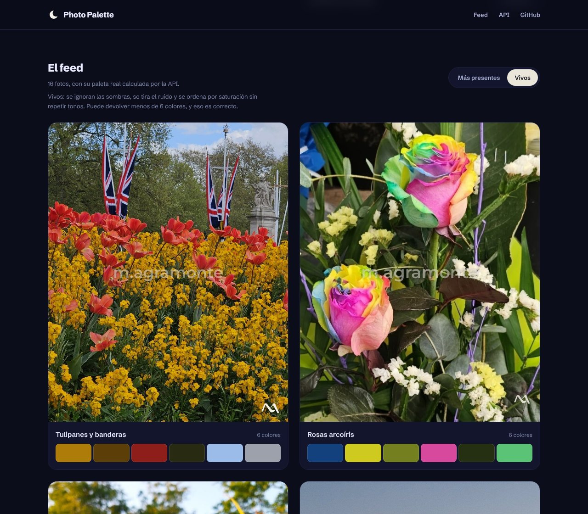
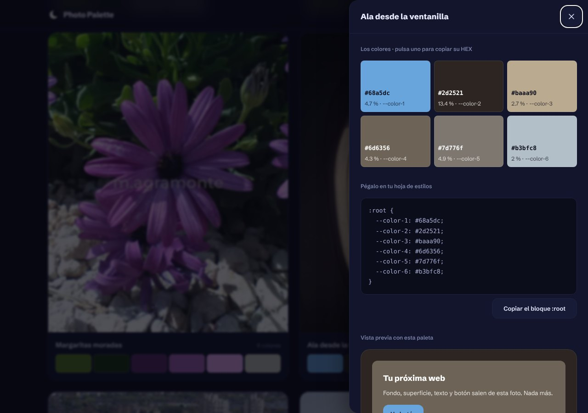
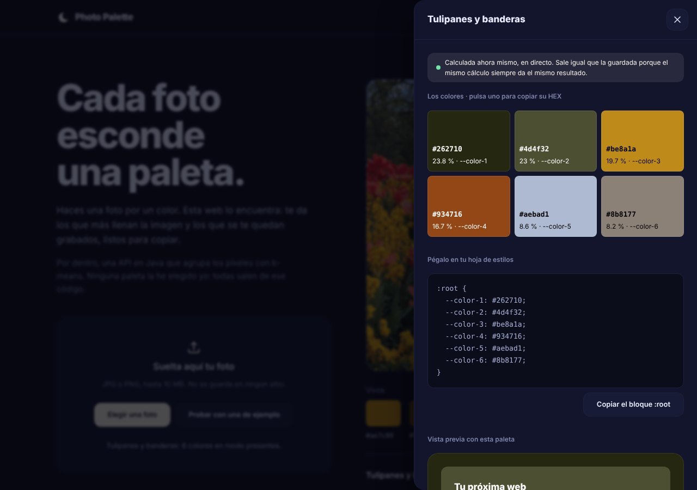
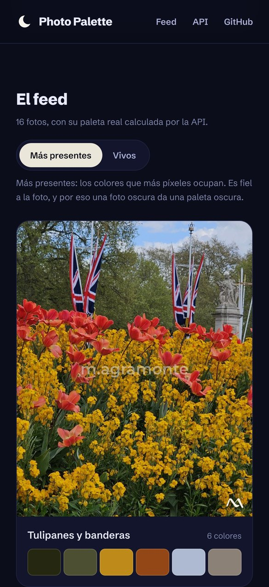

# Capturas

La web pantalla a pantalla, para quien prefiera no pulsar nada. Todas son de la aplicación
real, con las paletas que calcula la API sobre las fotos del feed. Se hicieron con la web del
repositorio y la API simulada dentro del navegador, igual que en las pruebas E2E: sus
respuestas salen de `paletas.json`, que genera el mismo código Java.

← [Volver al README](../README.md)

---

## La portada

El titular y, debajo, dos frases: una para cualquiera, que dice qué hace la web, y otra más
pequeña para quien programa. Después, la zona para soltar una foto y una foto del feed con sus
dos paletas a la vez. La
regla pegada a la foto mide lo que ocupa cada color «más presente»; debajo van los «vivos».
Verlas juntas es la idea del proyecto: la paleta fiel no es la paleta útil. «Otra foto» pasa
a la siguiente.

---

## Los dos modos, con la misma foto

A la izquierda, `presentes`: la paleta empieza por el verde casi negro de las hojas, que ocupa
el 24 % de la foto. A la derecha, `vivos`: empieza por el ocre de las flores amarillas y deja
entrar el rojo de los tulipanes, que en `presentes` ni aparece. Por qué existen los dos está en
[DECISIONES-TECNICAS.md](DECISIONES-TECNICAS.md#1-dos-modos-porque-contar-píxeles-da-paletas-apagadas).

---

## El feed en modo vivos

Cada tarjeta enseña la foto, su nombre, cuántos colores salen y las muestras. Los tulipanes y
las rosas arcoíris dan seis cada una; las fotos más apagadas, menos.

---

## El detalle de una paleta

Al pulsar una tarjeta se abre el panel: las muestras grandes, que copian su HEX con un clic;
el bloque `:root` listo para pegar, y una tarjeta de ejemplo pintada solo con esa paleta, con
el contraste calculado para que se vea que cumple WCAG AA.

---

## La API, en vivo

«Probar con una de ejemplo» coge una foto del feed y se la manda a la API. El panel avisa de
que esa paleta se acaba de calcular, y explica por qué sale idéntica a la guardada: el
k-means es determinista.

---

## En el móvil

El feed pasa a una columna, el interruptor se coloca bajo el título y las tarjetas mantienen
su recorte 4:5.

