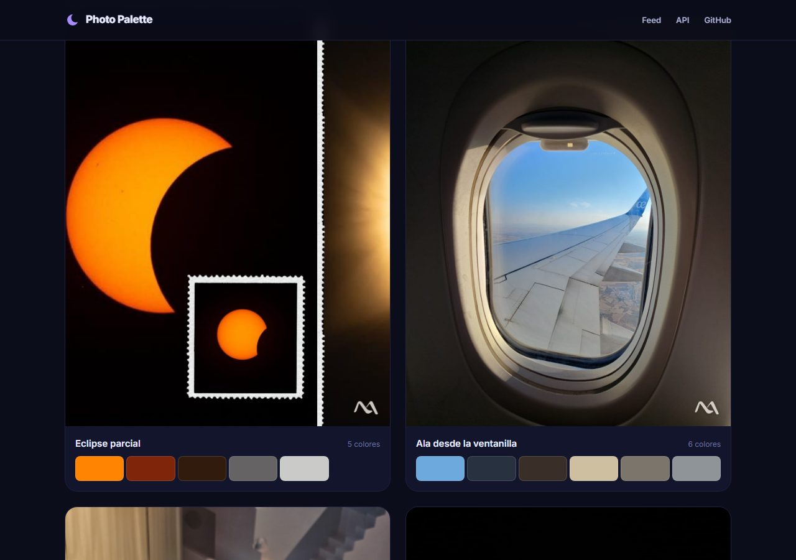
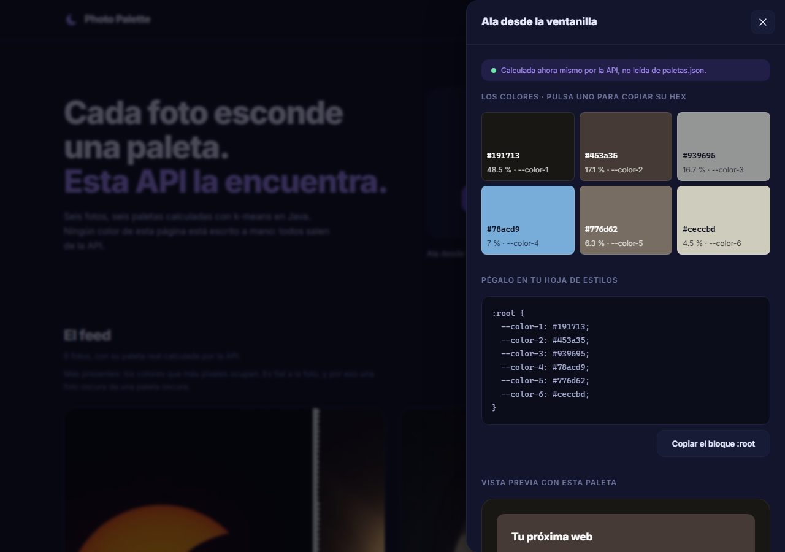
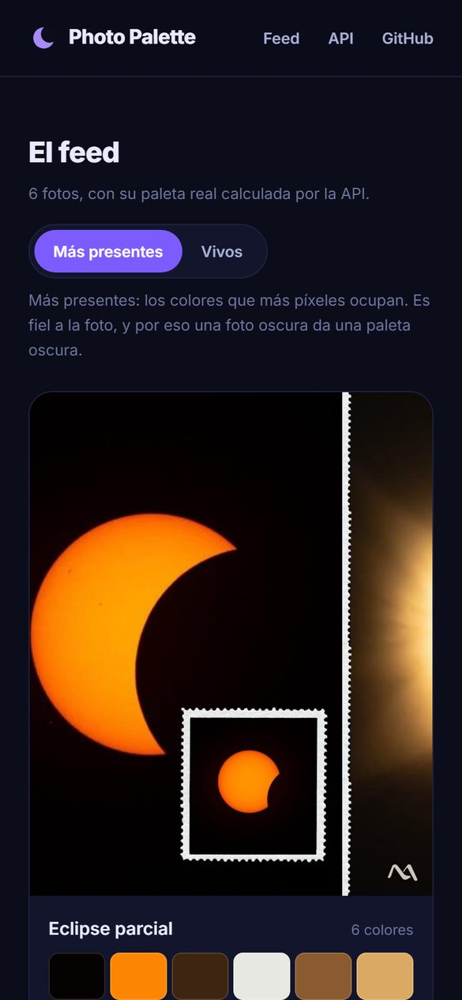

# Capturas

La web pantalla a pantalla, para quien prefiera no pulsar nada. Todas son de la aplicación
real, con las paletas que calcula la API sobre las seis fotos del feed.

← [Volver al README](../README.md)

---

## La portada

El titular, la zona para soltar una foto con sus dos botones y, debajo, el arranque del feed
con el interruptor entre los dos modos.

---

## Los dos modos, con la misma foto

A la izquierda, `presentes`: la paleta empieza por el negro, que ocupa el 70 % del eclipse.
A la derecha, `vivos`: empieza por el naranja del sol, se olvida de las sombras y se queda en
cinco colores. Por qué existen los dos está en
[DECISIONES-TECNICAS.md](DECISIONES-TECNICAS.md#1-dos-modos-porque-contar-píxeles-da-paletas-apagadas).

---

## El feed en modo vivos

Cada tarjeta enseña la foto, su nombre, cuántos colores salen y las muestras. El eclipse da
cinco y el ala vista desde la ventanilla, seis.

---

## El detalle de una paleta

Al pulsar una tarjeta se abre el panel: las muestras grandes, que copian su HEX con un clic;
el bloque `:root` listo para pegar, y una tarjeta de ejemplo pintada solo con esa paleta, con
el contraste calculado para que se vea que cumple WCAG AA.

---

## La API, en vivo

«Probar con una de ejemplo» coge una foto del feed y se la manda a la API. El panel avisa de
que esa paleta se acaba de calcular y no viene de `paletas.json`, y sale idéntica a la del
feed: el k-means es determinista.

---

## En el móvil

El feed pasa a una columna, el interruptor se coloca bajo el título y las tarjetas mantienen
su recorte 4:5.

